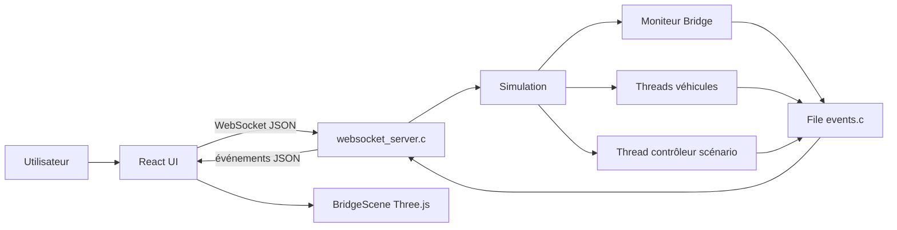
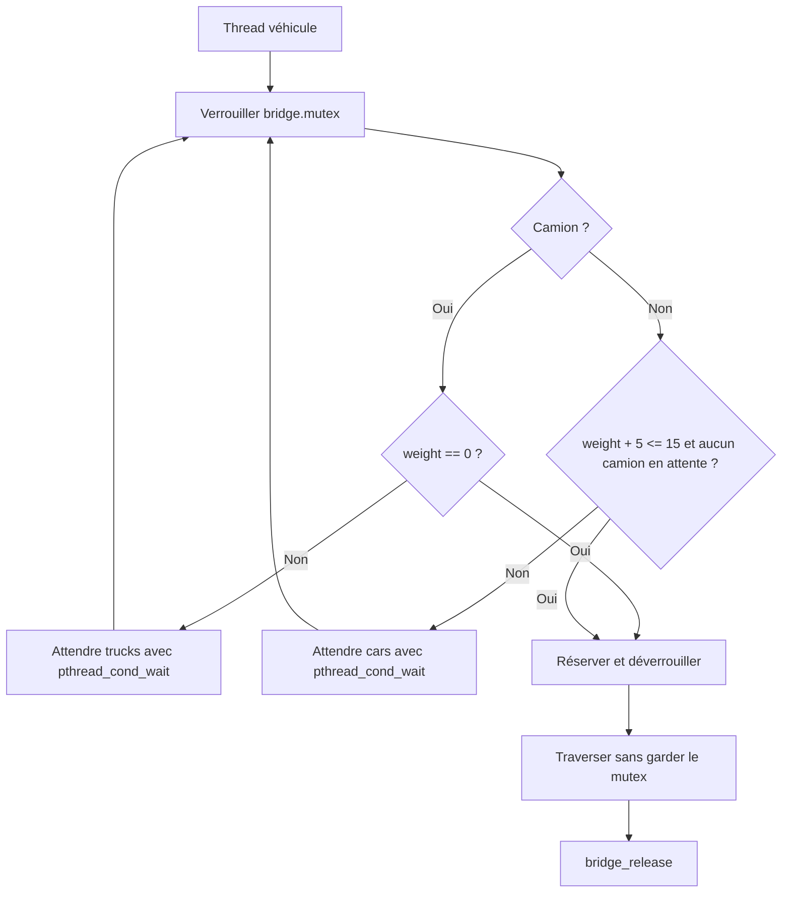
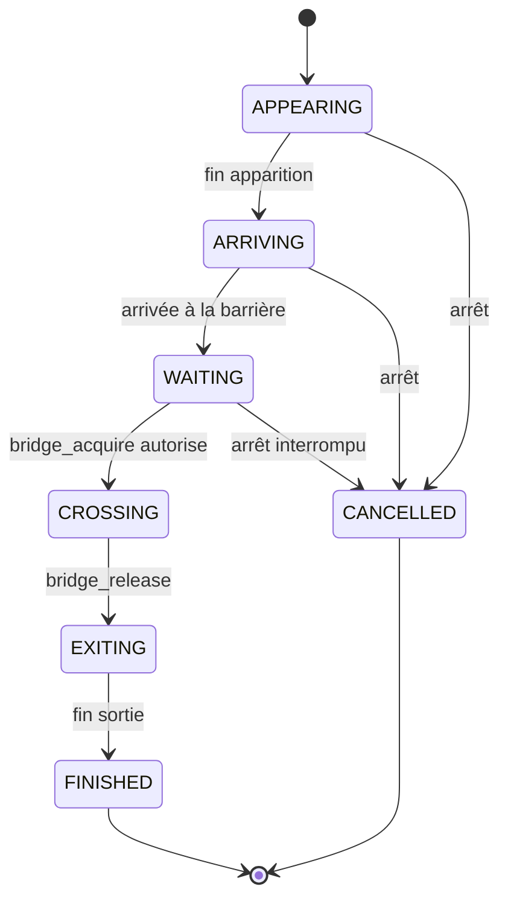
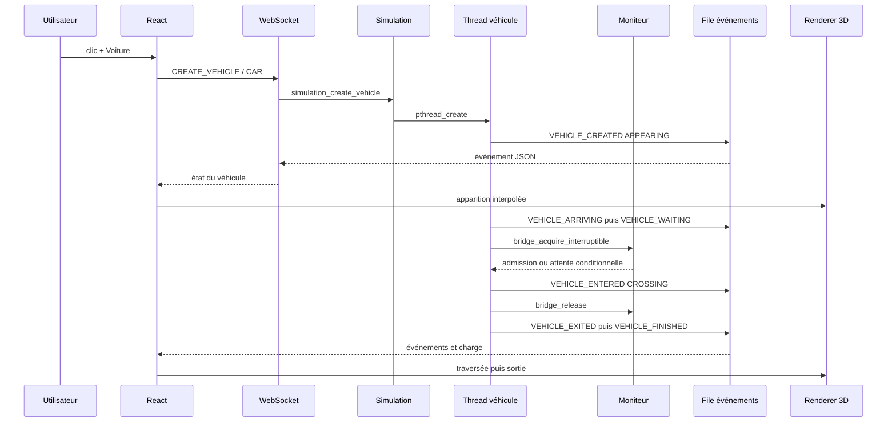

# Architecture et fonctionnement interne

English version: [Architecture and Internal Operation](ARCHITECTURE_EN.md).

Ce document décrit l’implémentation actuelle de Bridge Simulator. Il est destiné à accompagner une présentation universitaire : les noms de fonctions et les primitives POSIX correspondent au code du repository.

## 1. Vue générale

Le projet est organisé en trois couches :

1. **Backend C/POSIX** : décide de l’admission, crée les threads et protège l’état du pont.
2. **Communication** : le serveur WebSocket traduit les commandes JSON et transmet les événements JSON.
3. **Frontend React/Three.js** : affiche la scène, les files et les panneaux pédagogiques à partir des états reçus.



Le serveur C reste le processus principal. Il accepte un client WebSocket puis diffuse les événements pendant qu’il traite les commandes. Les threads de véhicules et de scénarios sont des `pthread_t` créés par le backend ; le renderer ne crée pas de thread POSIX et ne décide jamais de l’admission.

## 2. Organisation du backend

| Fichier | Responsabilité réelle |
|---|---|
| `backend/src/main.c` | Initialise la file d’événements et `Simulation`, puis lance le serveur WebSocket. |
| `backend/include/bridge.h` / `src/bridge.c` | Définit le pont, sa charge, les compteurs d’attente et le moniteur POSIX. |
| `backend/include/vehicle.h` / `src/vehicle.c` | Crée les threads véhicules, publie leurs états et les joint lors d’un arrêt. |
| `backend/include/simulation.h` / `src/simulation.c` | Contient le cycle de vie global, les générations, la pause, la vitesse, les snapshots et le contrôleur des scénarios. |
| `backend/include/events.h` / `src/events.c` | Implémente la file FIFO thread-safe des événements JSON. |
| `backend/src/websocket_server.c` | Effectue le handshake WebSocket, reçoit les commandes et envoie les événements. |
| `backend/include/scenarios.h` | Déclare les six fonctions de scénarios. |
| `backend/scenarios/scenario_common.c/.h` | Fournit une barrière POSIX, les étapes pédagogiques et l’attente commune des véhicules. |
| `backend/scenarios/*.c` | Implémente un scénario par fichier. |
| `backend/tests/test_bridge.c` | Vérifie le moniteur et quelques propriétés du cycle de vie. |

Le build CMake compile les mêmes sources de scénario pour `bridge_server` et `bridge_tests`. Le backend est compilé en C11 avec `-Wall -Wextra -Wpedantic` et lié à `Threads::Threads`.

## 3. État partagé de `Simulation`

La structure `Simulation` de `backend/include/simulation.h` regroupe :

- le mutex général et `pause_condition` ;
- le `Bridge` ;
- `stop_requested`, un `atomic_bool` utilisé pour réveiller les threads lors d’un arrêt ;
- `generation`, `scenario`, `state` et `speed` ;
- le compteur de threads actifs et les `pthread_t` des véhicules ;
- le thread contrôleur du scénario ;
- les `VehicleRecord` utilisés par le snapshot ;
- `demonstration_weight` et `bridge_collapsed` pour `RACE_CONDITION` ;
- `step_condition` et `step_requested` pour le mode pas-à-pas.

Les états globaux sont `IDLE`, `RUNNING`, `PAUSED`, `STOPPING`, `FINISHED` et `ERROR`. Les états des véhicules sont des états applicatifs envoyés dans les événements : `APPEARING`, `ARRIVING`, `WAITING`, `CROSSING`, `EXITING`, `FINISHED` ou `CANCELLED`. Ils ne sont pas des états fournis directement par l’ordonnanceur Linux.

## 4. Moniteur POSIX du pont

### Données protégées

`Bridge` contient :

- `weight` : charge courante ;
- `waiting_cars` et `waiting_trucks` : compteurs de threads en attente ;
- `crossing_cars` et `crossing_trucks` : véhicules actuellement admis ;
- `mutex` : protection de ces données ;
- `cars` et `trucks` : variables de condition séparées.

Les poids sont définis dans `bridge.c` : une voiture vaut 5 et un camion 15. La capacité est `BRIDGE_CAPACITY`, égale à 15 dans `bridge.h`.

### Admission

L’algorithme réel de `may_enter` est :

```c
if (type == VEHICLE_TRUCK) return bridge->weight == 0;
return bridge->weight + vehicle_weight(type) <= BRIDGE_CAPACITY
       && bridge->waiting_trucks == 0;
```

Conséquences :

- un camion entre uniquement lorsque le pont est vide ;
- une voiture entre si sa charge reste dans la capacité et qu’aucun camion n’attend déjà ;
- lorsqu’un camion attend, les nouvelles voitures cèdent la priorité.

L’attente est réalisée avec `bridge_acquire_interruptible`. Le thread incrémente son compteur d’attente, puis attend dans une boucle :

```c
while (!may_enter(bridge, type)
       && !(stop_requested && atomic_load(stop_requested))) {
    pthread_cond_wait(condition, &bridge->mutex);
}
```

`pthread_cond_wait` libère temporairement `bridge->mutex`, ce qui permet à un autre thread de modifier l’état du pont. Au réveil, le mutex est repris. La condition est vérifiée dans un `while`, car un réveil intempestif ou le réveil d’un thread qui n’est plus prioritaire ne constitue pas une autorisation.

Après l’admission, le mutex est libéré. Il protège la réservation et les compteurs, pas toute la durée de traversée. `bridge_release` décrémente la charge et réveille d’abord un camion si le pont est vide, sinon les voitures lorsqu’aucun camion n’attend.



## 5. Cycle de vie d’un véhicule

`vehicle_start` réserve un identifiant, enregistre un `VehicleRecord`, appelle `pthread_create` et conserve le `pthread_t`. `vehicle_join_all` joint les threads lors d’un reset, d’un changement de scénario ou de la destruction de la simulation.



Les durées logiques sont définies dans `backend/src/vehicle.c` : apparition 500 ms, approche 3000 ms, traversée 7000 ms et sortie 2000 ms. `simulation_wait_ms` les adapte à la vitesse sélectionnée et vérifie régulièrement la pause et l’arrêt.

## 6. Création d’une voiture



## 7. Synchronisation backend/frontend

Le principe est : **le backend décide, le frontend représente**.

Le backend publie les états avec `events_emit(generation, type, fields_json)`. `events.c` attribue un numéro de séquence et place le JSON dans une file protégée par `queue_mutex`. Le serveur appelle `events_pop` hors du mutex du pont et envoie les messages au client WebSocket.

Le hook `useSimulation.ts` reçoit les messages et applique `applyEvent`. Il rejette les événements dont `generation` est plus ancienne que la génération affichée. Lors d’une nouvelle connexion, le serveur envoie un `SNAPSHOT` construit par `simulation_snapshot_json`.

Lors d’un changement de scénario ou d’un reset, `stop_current` :

1. passe la simulation à `STOPPING` ;
2. positionne `stop_requested` ;
3. réveille pause, pas-à-pas et attente du pont ;
4. joint le contrôleur et les véhicules ;
5. remet le pont à zéro ;
6. incrémente la génération et vide la file d’événements.

Le mode pas-à-pas utilise `step_condition`. `scenario_emit_step` publie `SCENARIO_STEP`, puis le backend attend `simulation_step`. Le bouton frontend envoie seulement la commande `STEP`; il n’invente pas l’étape.

## 8. Protocole WebSocket

Le serveur écoute sur `localhost:8081`. Les exemples ci-dessous sont des messages conformes à la logique de parsing actuelle ; le serveur recherche les noms de commandes dans le texte JSON.

### Commandes frontend → backend

| Commande | Exemple | Fonction appelée |
|---|---|---|
| Création | `{"command":"CREATE_VEHICLE","vehicleType":"CAR"}` | `simulation_create_vehicle` |
| Scénario | `{"command":"START_SCENARIO","scenario":"DEADLOCK"}` | `simulation_start_scenario` |
| Reset | `{"command":"RESET"}` | `simulation_reset` |
| Pause | `{"command":"PAUSE"}` | `simulation_pause` |
| Reprise | `{"command":"RESUME"}` | `simulation_resume` |
| Vitesse | `{"command":"SET_SPEED","speed":2}` | `simulation_set_speed` |
| Pas-à-pas | `{"command":"SET_STEP_MODE","enabled":true}` | `simulation_set_step_mode` |
| Étape | `{"command":"STEP"}` | `simulation_step` |

### Événements backend → frontend

Les événements actuellement émis sont :

| Événement | Rôle |
|---|---|
| `SNAPSHOT` | Resynchronise génération, scénario, charge, files et véhicules. |
| `SCENARIO_STARTED`, `SCENARIO_STEP`, `SCENARIO_FINISHED` | Cycle pédagogique d’un scénario. |
| `SIMULATION_STATE_CHANGED`, `SIMULATION_RESET`, `SPEED_CHANGED` | État global et commandes de contrôle. |
| `THREAD_COUNT_CHANGED` | Nombre de threads applicatifs actifs. |
| `VEHICLE_CREATED`, `VEHICLE_ARRIVING`, `VEHICLE_WAITING`, `VEHICLE_ENTERED`, `VEHICLE_EXITED`, `VEHICLE_FINISHED` | Cycle de vie graphique et logique des véhicules. |
| `BRIDGE_STATE`, `MONITOR_EVENT` | Charge, files, compteurs et étapes du moniteur. |
| `RACE_READ`, `RACE_DECISION`, `BRIDGE_COLLAPSED` | Interleaving contrôlé de `RACE_CONDITION`. |
| `RESOURCE_STATE`, `DEADLOCK_DETECTED` | Ressources détenues et cycle d’attente. |
| `BUSY_WAIT_RESULT` | Nombre de sondages et temps CPU mesuré par `clock()`. |
| `STARVATION_METRIC` | Véhicule retardé, camions servis et temps logique. |
| `PRIORITY_EVENT`, `PRIORITY_VARIANT` | Timeline contrôlée et résultat du test d’héritage. |
| `STEP_MODE_CHANGED`, `STEP_GRANTED` | Contrôle du pas-à-pas. |
| `ERROR` | Refus ou erreur de création/lancement. |

Un événement porte normalement `type`, `sequence` et `generation`, puis ses champs spécifiques. Les snapshots bruts ne reçoivent pas de séquence supplémentaire car ils sont ajoutés directement à la file par `events_push_raw`.

## 9. Scénarios de concurrence

### NORMAL — moniteur et priorité

`normal.c` crée trois voitures, un camion, puis deux voitures supplémentaires. Les véhicules réels passent par `vehicle_start` et `bridge_acquire_interruptible`. Le scénario illustre l’occupation à 15 tonnes, l’attente du camion et le blocage des voitures derrière une demande camion prioritaire.

Événements pédagogiques : `SCENARIO_STEP`, `MONITOR_EVENT`, `BRIDGE_STATE`, événements du cycle véhicule. La limite vérifiée est la capacité du moniteur ; les tests automatisés couvrent directement les propriétés de base du pont.

### RACE_CONDITION — test puis action non atomiques

`race_condition.c` utilise deux threads et une `ScenarioBarrier`. Les deux threads lisent 10 tonnes, passent chacun la décision `10 + 5 <= 15`, puis incrémentent une charge de démonstration protégée par `weight_mutex`. Cette synchronisation contrôle l’entrelacement sans créer de data race C indéfinie.

La charge affichée atteint 20 tonnes et produit `BRIDGE_COLLAPSED`. Cette charge est volontairement séparée de `Bridge`, afin de ne pas corrompre le moniteur normal. La scène passe en état d’alerte ; ce n’est pas une preuve que le moniteur a accepté une surcharge réelle.

### STARVATION — priorité stricte

`starvation.c` crée un camion, puis une voiture, puis trois camions supplémentaires au maximum. Les événements `STARVATION_METRIC` exposent `waitingVehicleId`, `trucksServed`, `waitingMs`, `priority` et `risk`.

La démonstration est bornée. Elle montre le risque d’une attente prolongée lorsqu’un flux de camions prioritaires continue, mais une exécution finie ne prouve pas une famine infinie.

### DEADLOCK — cycle de ressources récupérable

`deadlock.c` crée deux mutex locaux : `barrier_mutex` et `balance_mutex`. T1 prend le premier et tente le second ; T2 prend le second et tente le premier. Les `trylock` contrôlés reproduisent le cycle sans bloquer le serveur WebSocket. `stop_requested` permet de sortir des boucles et les deux threads sont joints avant la destruction des mutex.

Les événements `RESOURCE_STATE` alimentent le panneau `RESOURCE GRAPH` et `DEADLOCK_DETECTED` indique le cycle `T1 -> T2 -> T1`.

### BUSY_WAITING — boucle active contre condition

`busy_waiting.c` lance un thread qui incrémente `iterations` dans une boucle active et un autre qui dort dans `pthread_cond_wait`. Après une durée bornée, le backend positionne `released`, diffuse la condition et joint les deux threads.

`BUSY_WAIT_RESULT` contient `checks`, `conditionWakeups` et `cpuMs`, calculé avec `clock()`. Le frontend affiche ces mesures sans fabriquer de valeur CPU.

### PRIORITY_INVERSION — timeline contrôlée

`priority_inversion.c` crée trois tâches applicatives : T1 faible, T2 moyenne et T3 haute. T1 prend `resource`, T3 attend, puis T2 exécute son travail. Le scénario compare `NO_INHERIT` et `PRIO_INHERIT` lorsque la plateforme expose `PTHREAD_PRIO_INHERIT`.

Les événements `PRIORITY_EVENT` portent l’identifiant, la priorité demandée, l’état logique, le mutex détenu ou attendu et l’action. `PRIORITY_VARIANT` indique si l’héritage a effectivement été appliqué. Il s’agit d’une timeline contrôlée, pas d’une mesure directe des priorités du scheduler Linux.

## 10. Limites et garanties

### Garanties du code

- Le moniteur protège les compteurs du pont avec un mutex.
- Les conditions d’admission sont vérifiées sous verrou.
- Les threads véhicules sont joints lors des transitions de simulation.
- Les scénarios sont bornés et isolés par une génération.
- Les événements obsolètes sont rejetés par le frontend.
- Le test de surcharge est séparé du pont normal.

### Limites

- Une animation Three.js ne représente pas directement l’ordonnancement CPU.
- Les états `RUNNING`, `BLOCKED` et `READY` des panneaux sont des états logiques instrumentés par le scénario.
- Une politique de priorité stricte peut retarder une voiture.
- `PTHREAD_PRIO_INHERIT` peut dépendre de la plateforme et de permissions particulières.
- Le rendu ne constitue pas une preuve de correction du moniteur ; les propriétés de synchronisation doivent être vérifiées par le code et les tests.
- Le serveur actuel est conçu pour le client local du simulateur, pas comme un service WebSocket multi-client complet.

## 11. Comment modifier le projet

| Besoin | Emplacement à modifier |
|---|---|
| Changer la capacité | `backend/include/bridge.h`, constante `BRIDGE_CAPACITY`. |
| Changer le poids voiture/camion | `vehicle_weight` dans `backend/src/bridge.c` et `backend/src/vehicle.c`. |
| Changer les durées | Constantes `APPEARANCE_MS`, `APPROACH_MS`, `CROSSING_MS`, `EXIT_MS` dans `backend/src/vehicle.c`; durées visuelles dans `frontend/src/simulationConfig.ts`. |
| Modifier la priorité | `may_enter` et `bridge_release` dans `backend/src/bridge.c`. |
| Ajouter un événement | Appeler `events_emit` dans le module concerné, avec la génération courante. Ajouter son type dans `SimulationEvent` si le frontend l’exploite. |
| Modifier le modèle 3D | `frontend/src/components/scene/BridgeScene.tsx`, notamment `VehicleModel`, `Bridge`, `Road` et `Barrier`. |
| Modifier les coordonnées de scène | `frontend/src/sceneConfig.ts`. |
| Modifier l’interprétation des événements | `frontend/src/hooks/useSimulation.ts`, fonction `applyEvent`. |
| Ajouter un scénario | Ajouter `ScenarioKind`, une déclaration dans `scenarios.h`, un fichier dans `backend/scenarios/`, un cas dans `scenario_controller`, puis l’ajouter à CMake/Makefile et au frontend. |
| Modifier le pas-à-pas | `scenario_common.c` pour les étapes et `simulation.c` pour `step_condition`, `simulation_step` et `simulation_wait_for_step`. |

## 12. Tests et vérifications

Le test `backend/tests/test_bridge.c` contient trois groupes principaux :

1. trois voitures admises et retour à zéro après libération ;
2. priorité du camion lorsqu’une voiture occupe le pont ;
3. reset de `Simulation`, jointure des threads, remise à zéro et changement de génération.

Il contient également un test du mécanisme backend pas-à-pas. Les scénarios complets, le protocole WebSocket et le rendu 3D doivent être vérifiés par lancement manuel.

Commandes documentées :

```bash
cmake -S backend -B backend/build
cmake --build backend/build
./backend/build/bridge_tests
ctest --test-dir backend/build --output-on-failure
./backend/build/bridge_server
```

Frontend :

```bash
cd frontend
npm install
npm run check
npm run build
npm run dev
```

Le backend écoute sur `ws://localhost:8081` et Vite sert normalement l’interface sur `http://localhost:5173`.
