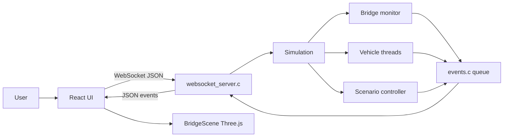
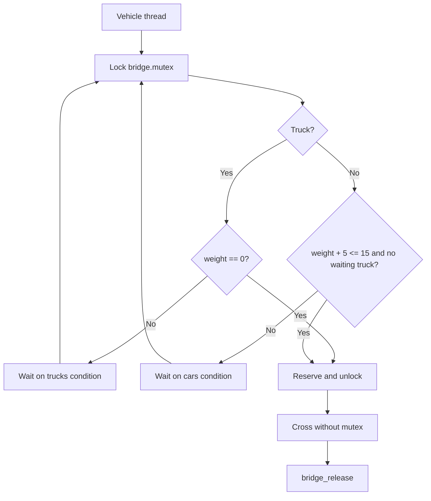
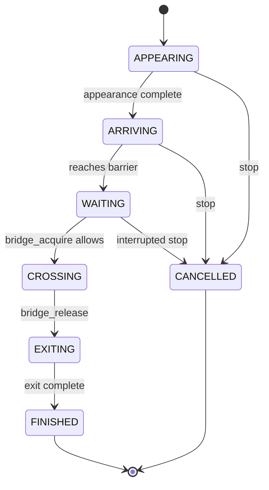
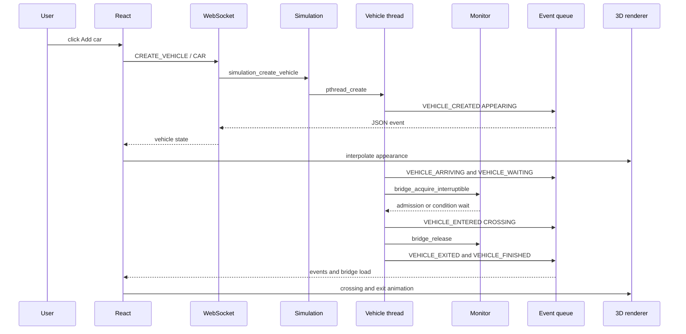

# Architecture and Internal Operation

This document describes the current implementation of Bridge Simulator. It is intended for a university presentation and uses the actual functions, files and POSIX primitives present in the repository.

## 1. General architecture

The project has three layers:

1. **C/POSIX backend**: admission decisions, threads and bridge synchronization.
2. **Communication layer**: WebSocket commands and JSON events.
3. **React/Three.js frontend**: 3D rendering, controls and educational panels.



The main server process accepts a WebSocket client, handles commands and drains the event queue. Vehicle and scenario workers are real `pthread_t` threads created by the backend. The renderer does not decide whether a vehicle may enter.

## 2. Backend modules

| File | Responsibility |
|---|---|
| `backend/src/main.c` | Initializes events and `Simulation`, then starts the WebSocket server. |
| `backend/include/bridge.h`, `backend/src/bridge.c` | Bridge data, capacity rules, condition variables and monitor operations. |
| `backend/include/vehicle.h`, `backend/src/vehicle.c` | Vehicle threads, lifecycle events and joining during shutdown. |
| `backend/include/simulation.h`, `backend/src/simulation.c` | Global lifecycle, generations, pause, speed, snapshots, reset and scenario controller. |
| `backend/include/events.h`, `backend/src/events.c` | Thread-safe FIFO queue of JSON events. |
| `backend/src/websocket_server.c` | WebSocket handshake, command parsing and event transmission. |
| `backend/include/scenarios.h` | Public declarations for the six scenarios. |
| `backend/scenarios/scenario_common.c/.h` | Scenario barrier, pedagogical steps and common vehicle waiting. |
| `backend/scenarios/*.c` | One implementation file per scenario. |
| `backend/tests/test_bridge.c` | Monitor and lifecycle tests. |

The CMake build compiles the scenario sources into both `bridge_server` and `bridge_tests`. The backend uses C11, warnings enabled, and `Threads::Threads`.

## 3. Shared `Simulation` state

`backend/include/simulation.h` defines the central `Simulation` structure. It contains:

- the global mutex and `pause_condition`;
- the `Bridge` monitor;
- `stop_requested`, an `atomic_bool` used for cooperative shutdown;
- generation, scenario, simulation state and speed;
- active-thread counters and vehicle `pthread_t` handles;
- the scenario controller thread;
- `VehicleRecord` values used by snapshots;
- demonstration fields for the controlled race-condition collapse;
- `step_condition` and `step_requested` for backend-driven step mode.

Global states are `IDLE`, `RUNNING`, `PAUSED`, `STOPPING`, `FINISHED` and `ERROR`. Vehicle states such as `APPEARING`, `ARRIVING`, `WAITING`, `CROSSING`, `EXITING`, `FINISHED` and `CANCELLED` are application states emitted by the backend, not direct Linux scheduler states.

## 4. POSIX bridge monitor

### Protected data

`Bridge` stores:

- `weight`, the current bridge load;
- `waiting_cars` and `waiting_trucks`;
- `crossing_cars` and `crossing_trucks`;
- `mutex`, protecting the shared data;
- separate `cars` and `trucks` condition variables.

`bridge.h` defines `BRIDGE_CAPACITY` as 15. `bridge.c` assigns 5 tons to a car and 15 tons to a truck.

### Admission policy

The actual `may_enter` logic is:

```c
if (type == VEHICLE_TRUCK) return bridge->weight == 0;
return bridge->weight + vehicle_weight(type) <= BRIDGE_CAPACITY
       && bridge->waiting_trucks == 0;
```

Therefore:

- a truck enters only when the bridge is empty;
- a car enters only if capacity remains and no truck is waiting;
- newly arriving cars yield to a waiting truck.

`bridge_acquire_interruptible` increments the appropriate waiting counter and waits under the bridge mutex:

```c
while (!may_enter(bridge, type)
       && !(stop_requested && atomic_load(stop_requested))) {
    pthread_cond_wait(condition, &bridge->mutex);
}
```

`pthread_cond_wait` temporarily releases the mutex, allowing another thread to change the bridge state. The condition is checked in a `while` loop because a wake-up is not itself an admission decision.

Once admitted, the mutex is released before the crossing. It protects the reservation and counters, not the whole crossing duration. `bridge_release` decreases the load and signals a waiting truck first when the bridge becomes empty; cars are broadcast only when no truck is waiting.



## 5. Vehicle lifecycle

`vehicle_start` allocates an identifier, registers a `VehicleRecord`, calls `pthread_create` and stores the resulting handle. `vehicle_join_all` joins vehicle threads during reset, scenario changes and destruction.



The logical durations are defined in `backend/src/vehicle.c`: 500 ms appearance, 3000 ms approach, 7000 ms crossing and 2000 ms exit. `simulation_wait_ms` applies the selected speed and checks pause and shutdown.

## 6. Creating a car



## 7. Backend/frontend synchronization

The rule is: **the backend decides; the frontend represents**.

The backend calls `events_emit(generation, type, fields_json)`. `events.c` assigns a sequence number and appends the JSON to a FIFO protected by `queue_mutex`. The WebSocket server calls `events_pop` and sends messages to the client.

`useSimulation.ts` parses each message and applies it through `applyEvent`. Events from an older `generation` are ignored. When a client connects, the server sends a `SNAPSHOT` produced by `simulation_snapshot_json`.

During reset or scenario replacement, `stop_current` sets `STOPPING`, sets `stop_requested`, wakes pause/step/bridge waiters, joins the controller and vehicle threads, resets the bridge, and then the new generation clears the old event queue.

Step mode uses `step_condition`. `scenario_emit_step` emits `SCENARIO_STEP` and waits for `simulation_step`. The frontend `Étape suivante` control only sends `STEP`; it does not invent a transition with a React counter.

## 8. WebSocket protocol

The server listens on `localhost:8081`. The current parser searches command names in the received JSON text.

### Frontend to backend commands

| Command | Example | Backend function |
|---|---|---|
| Create vehicle | `{"command":"CREATE_VEHICLE","vehicleType":"CAR"}` | `simulation_create_vehicle` |
| Start scenario | `{"command":"START_SCENARIO","scenario":"DEADLOCK"}` | `simulation_start_scenario` |
| Reset | `{"command":"RESET"}` | `simulation_reset` |
| Pause | `{"command":"PAUSE"}` | `simulation_pause` |
| Resume | `{"command":"RESUME"}` | `simulation_resume` |
| Speed | `{"command":"SET_SPEED","speed":2}` | `simulation_set_speed` |
| Step mode | `{"command":"SET_STEP_MODE","enabled":true}` | `simulation_set_step_mode` |
| Grant step | `{"command":"STEP"}` | `simulation_step` |

### Backend to frontend events

The current event types include:

`SNAPSHOT`, `SCENARIO_STARTED`, `SCENARIO_STEP`, `SCENARIO_FINISHED`, `SIMULATION_STATE_CHANGED`, `SIMULATION_RESET`, `SPEED_CHANGED`, `THREAD_COUNT_CHANGED`, `VEHICLE_CREATED`, `VEHICLE_ARRIVING`, `VEHICLE_WAITING`, `VEHICLE_ENTERED`, `VEHICLE_EXITED`, `VEHICLE_FINISHED`, `BRIDGE_STATE`, `MONITOR_EVENT`, `RACE_READ`, `RACE_DECISION`, `BRIDGE_COLLAPSED`, `RESOURCE_STATE`, `DEADLOCK_DETECTED`, `BUSY_WAIT_RESULT`, `STARVATION_METRIC`, `PRIORITY_EVENT`, `PRIORITY_VARIANT`, `STEP_MODE_CHANGED`, `STEP_GRANTED` and `ERROR`.

Regular events contain `type`, `sequence` and `generation`, followed by event-specific fields. A snapshot contains the current scenario, state, speed, load, queues, collapse flag and vehicle list.

## 9. Scenario analysis

### NORMAL

`normal.c` creates three cars, one truck and two additional cars. Real vehicle threads use `vehicle_start` and `bridge_acquire_interruptible`. The scenario demonstrates 15-ton capacity, truck waiting and car blocking behind a waiting truck.

### RACE_CONDITION

`race_condition.c` uses two threads and `ScenarioBarrier`. Both threads read 10 tons, independently decide that `10 + 5 <= 15`, then update a demonstration load protected by `weight_mutex`. The barrier controls the interleaving without introducing undefined C data races. The displayed load reaches 20 tons and emits `BRIDGE_COLLAPSED`; the normal `Bridge` monitor is not corrupted.

### STARVATION

`starvation.c` creates one truck, then a car and at most three additional trucks. `STARVATION_METRIC` reports the delayed vehicle, trucks served, logical waiting time and truck priority. The finite run demonstrates risk, not infinite starvation.

### DEADLOCK

`deadlock.c` creates two local mutexes. T1 holds `barrier_mutex` and attempts `balance_mutex`; T2 holds `balance_mutex` and attempts `barrier_mutex`. Controlled `trylock` loops reproduce the dependency cycle without blocking the WebSocket server. `stop_requested` releases the demonstration safely, and both threads are joined before mutex destruction.

### BUSY_WAITING

`busy_waiting.c` compares a loop that increments `iterations` with a thread blocked in `pthread_cond_wait`. After a bounded interval, the backend sets `released`, broadcasts the condition and joins both threads. `BUSY_WAIT_RESULT` reports checks, condition wake-ups and `clock()` CPU time.

### PRIORITY_INVERSION

`priority_inversion.c` creates application tasks T1 low, T2 medium and T3 high. T1 holds `resource`, T3 waits and T2 performs work. The scenario compares `NO_INHERIT` and `PRIO_INHERIT` when `PTHREAD_PRIO_INHERIT` is available. The events expose requested priorities and logical states; they are not direct Linux scheduler measurements.

## 10. Limits and guarantees

### Code guarantees

- bridge counters are protected by the monitor mutex;
- admission predicates are checked while holding that mutex;
- vehicle threads are joined during simulation transitions;
- scenarios are bounded and isolated by generation;
- stale events are rejected by the frontend;
- the race-condition overload is separate from the normal monitor.

### Limits

- Three.js animation does not directly represent CPU scheduling.
- `RUNNING`, `BLOCKED` and `READY` in the panels are instrumented application states.
- Strict truck priority can delay a car.
- `PTHREAD_PRIO_INHERIT` depends on platform support and permissions.
- Rendering is not a proof of monitor correctness; code and tests remain authoritative.
- The server is designed for the local simulator client, not a complete multi-client service.

## 11. How to modify the project

| Goal | Location |
|---|---|
| Change bridge capacity | `backend/include/bridge.h`, `BRIDGE_CAPACITY`. |
| Change vehicle weights | `vehicle_weight` in `backend/src/bridge.c` and `backend/src/vehicle.c`. |
| Change timings | `APPEARANCE_MS`, `APPROACH_MS`, `CROSSING_MS`, `EXIT_MS` in `backend/src/vehicle.c`; visual timings in `frontend/src/simulationConfig.ts`. |
| Change priority policy | `may_enter` and `bridge_release` in `backend/src/bridge.c`. |
| Add an event | Call `events_emit` with the current generation; add fields to `SimulationEvent` if the frontend consumes them. |
| Change vehicle 3D model | `frontend/src/components/scene/BridgeScene.tsx`, especially `VehicleModel`. |
| Change scene geometry | `frontend/src/sceneConfig.ts`. |
| Interpret an event | `frontend/src/hooks/useSimulation.ts`, `applyEvent`. |
| Add a scenario | Add a `ScenarioKind`, declaration, `backend/scenarios/*.c` implementation, controller case, build source and frontend label. |
| Change step mode | `scenario_common.c` for steps and `simulation.c` for `step_condition`. |

## 12. Tests and verification

`backend/tests/test_bridge.c` verifies three cars and the 15-ton limit, release to zero, truck priority, reset/thread joining, generation changes and backend step-mode authorization. Complete scenarios, WebSocket interaction and 3D rendering are manually validated.

```bash
cmake -S backend -B backend/build
cmake --build backend/build
./backend/build/bridge_tests
ctest --test-dir backend/build --output-on-failure
./backend/build/bridge_server
```

Frontend checks:

```bash
cd frontend
npm install
npm run check
npm run build
npm run dev
```

The backend uses `ws://localhost:8081`; Vite normally serves the frontend at `http://localhost:5173`.
