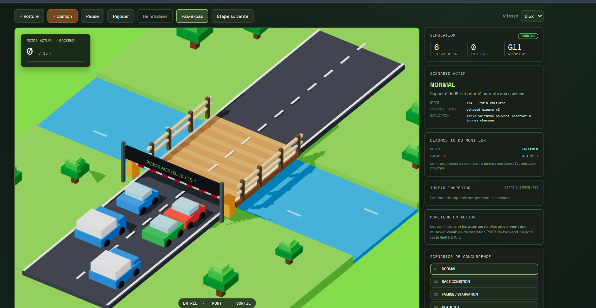
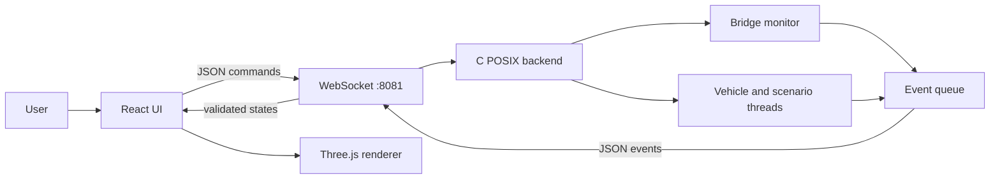

# Bridge Simulator — POSIX Real-Time Systems

Educational 3D simulator for synchronization and concurrency based on POSIX threads.

     

## Overview

Bridge Simulator models a bridge with limited capacity. The C/POSIX backend makes all synchronization decisions; the React/Three.js frontend displays the scene, vehicles and validated events.

The scene includes the bridge, river, two lanes, barrier, vehicle queues and a teaching dashboard. Specialized panels make thread states and resource dependencies visible for abstract concurrency scenarios.



The screenshot shows the low-poly bridge scene, the river, waiting vehicles, the barrier, simulation controls and the backend-driven dashboard.

## TP1 context

- Maximum bridge capacity: **15 tons**.
- A car weighs **5 tons**.
- A truck weighs **15 tons**.
- Each vehicle is represented by a real `pthread_create` thread.
- The bridge is protected by a monitor using a `pthread_mutex_t` and two condition variables.
- Waiting trucks have priority over newly arriving cars.

In normal operation, the main invariant is:

```text
0 <= bridge_load <= 15
```

The `RACE_CONDITION` scenario intentionally demonstrates a controlled violation of this invariant to explain why checking and reserving capacity must be atomic.

## Features

- manual car and truck creation;
- joinable POSIX vehicle threads and clean shutdown;
- bridge monitor with mutual exclusion and condition variables;
- truck priority policy;
- low-poly 3D scene with roads, bridge, river, barrier and vehicles;
- backend-controlled queues and bridge load;
- event timeline and thread inspector;
- pause, `0.5x`, `1x`, `2x` speeds and backend-driven step mode;
- six bounded and reproducible concurrency scenarios;
- WebSocket communication on `ws://localhost:8081`.

## Six scenarios

| Scenario | Concept | Goal |
|---|---|---|
| Normal | POSIX monitor | Respect capacity and priority |
| Race Condition | Atomicity | Show an incorrect concurrent admission |
| Starvation | Fairness | Illustrate the risk of starvation |
| Deadlock | Resource cycle | Show a circular wait between two mutexes |
| Busy Waiting | Synchronization | Compare active and blocking waits |
| Priority Inversion | Scheduling | Illustrate priority inversion |

`RACE_CONDITION`, `DEADLOCK`, `BUSY_WAITING`, `STARVATION` and `PRIORITY_INVERSION` are controlled demonstrations. They make concurrency phenomena reproducible, but they are not all direct measurements of the Linux real-time scheduler.

## Technologies

| Technology | Role |
|---|---|
| C11 + POSIX Threads | Monitor, vehicles, scenarios and synchronization |
| CMake | Backend and test builds |
| React + TypeScript | UI, commands and application state |
| React Three Fiber + Three.js | Low-poly 3D rendering and animation |
| WebSocket | Bidirectional command and event transport |

## Installation and execution

### Requirements

- Linux or WSL with `gcc`, POSIX threads and CMake `>= 3.16`;
- Node.js and npm for the frontend.

The backend uses POSIX primitives. On Windows, use WSL or a POSIX-compatible MinGW-w64 environment. The legacy MinGW.org distribution without `pthread.h` is not suitable.

### Build the backend from the repository root

```bash
cmake -S backend -B backend/build
cmake --build backend/build
```

### Start the backend

```bash
./backend/build/bridge_server
```

The server must stay running and print:

```text
Bridge Simulator WebSocket: ws://localhost:8081
```

Port `8080` may be used by another process; Bridge Simulator intentionally uses `8081`.

### Start the frontend

In a second terminal:

```bash
cd frontend
npm install
npm run dev
```

Open [http://localhost:5173](http://localhost:5173). The frontend does not fake a missing backend: when the WebSocket is unavailable, it displays `BACKEND DÉCONNECTÉ` and disables commands.

### Step-by-step mode

Enable `Pas-à-pas`, start a scenario, then use `Étape suivante`. Each step is released by a POSIX condition in the backend; progression is not invented by a React timer.

## Tests

```bash
cmake --build backend/build --target bridge_tests
./backend/build/bridge_tests
ctest --test-dir backend/build --output-on-failure
```

The tests in `backend/tests/test_bridge.c` cover:

- admission of three cars, reaching 15 tons;
- return to zero after release;
- truck priority when a car is already crossing;
- thread joining during reset;
- generation changes;
- backend step-mode authorization.

Complete scenarios and 3D animations are primarily validated manually.

## Architecture at a glance



The central rule is: **the backend decides; the frontend represents**.

## Project structure

```text
.
├── backend/
│   ├── include/bridge.h, events.h, scenarios.h, simulation.h, vehicle.h
│   ├── scenarios/
│   │   ├── scenario_common.c/.h
│   │   ├── normal.c, race_condition.c, starvation.c
│   │   ├── deadlock.c, busy_waiting.c, priority_inversion.c
│   ├── src/bridge.c, events.c, simulation.c, vehicle.c
│   ├── src/websocket_server.c, main.c
│   └── tests/test_bridge.c
├── frontend/src/
│   ├── components/scene/BridgeScene.tsx
│   ├── hooks/useSimulation.ts
│   ├── main.tsx, sceneConfig.ts, simulationConfig.ts
├── ARCHITECTURE.md
├── ARCHITECTURE_EN.md
└── README.md
```

## Further documentation

- [Architecture et fonctionnement interne — français](ARCHITECTURE.md)
- [Architecture and internal operation — English](ARCHITECTURE_EN.md)

The project connects real-time systems concepts—mutexes, condition variables, deadlocks, starvation and priority inversion—to an observable 3D visualization while keeping synchronization decisions in real C/POSIX code.
